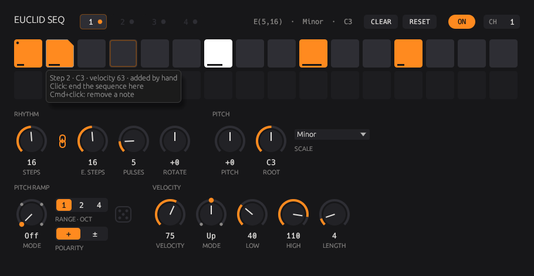

# Euclid Seq



A minimal 4-track euclidean MIDI step sequencer, built in Rust with [nih-plug](https://github.com/robbert-vdh/nih-plug). Exports **CLAP** (note effect) and **VST3**.

## Tracks

Four independent tracks, one per page. Click the **1–4** tabs to switch. A tab's dot lights up when its track fires a note, and dims when the track is off. Every control below is per track.

- **ON / OFF** – only track 1 is on by default.
- **CH** – MIDI channel (defaults: track 1 → ch 1, track 2 → ch 2, …). Drag or scroll.
- **CLEAR** – removes every note from the track (Pulses to 0, manual edits cleared).
- **RESET** – returns all of the track's settings to their defaults and clears manual edits. It keeps ON and CH, so the track isn't silenced or rerouted.

## Controls

**Rhythm**

| Control | Range | What it does |
|---|---|---|
| Steps | 1–32 | Sequence length. The grid loops after this step. You can also click a grid cell to end the sequence there. |
| Link (chain icon) | on / off | Ties Steps and E. Steps together: turning either one moves both. Unlinking keeps the shared value. |
| E. Steps | 1–32 | Length of the euclidean cycle. It repeats inside the sequence and restarts when the sequence wraps. |
| Pulses | 0–32 | Hits spread evenly over the euclidean cycle (Bjorklund's algorithm, clamped to E. Steps). |
| Rotate | −16…+16 | Shifts the hits right (+) or left (−), wrapping inside the euclidean cycle. |

**Pitch**

| Control | Range | What it does |
|---|---|---|
| Pitch | −14…+14 | Transposition in **scale degrees**, so the sequence always stays in key. |
| Root | C0–C6 | Root note (MIDI 60 = C3, the Ableton/Bitwig convention). Type a value like `F#2` or `54`. |
| Scale | 8 scales | Major, Minor, Dorian, Mixolydian, Harmonic Minor, Major Pentatonic, Minor Pentatonic, Chromatic. |

**Pitch ramp** – gives each step its own pitch, always locked to the scale.

| Control | Options | What it does |
|---|---|---|
| Mode | Off / Up / Down / Random | Up and Down sweep across the whole sequence; Random gives every step a fixed random note. |
| Range | 1 / 2 / 4 oct | How far the ramp reaches. |
| Polarity | + / ± | `+` goes from the root upwards; `±` spans below and above the root. |
| Dice | – | (Random only) re-rolls the random melody. The melody is saved with your project. |

The ramp is tied to step positions, not to hits. So Rotate, Pulses and E. Steps change *which* notes of the contour get played, which makes them a quick way to vary a melody. With a ramp active, each grid cell shows its pitch as a short line (higher line = higher note), and hovering a cell shows its note name.

**Velocity**

| Control | Range | What it does |
|---|---|---|
| Velocity | 0–127 (default 75) | Fixed velocity, used when the ramp is off or its length is 1. 0 is silent (MIDI treats it as a note-off). |
| Mode | Off / Up / Down | Ramp from Low to High (Up) or High to Low (Down). |
| Low / High | 0–127 | The two values the ramp moves between. |
| Length | 1 … notes in pattern | Notes per ramp before it starts again. 2 alternates Low/High; 1 = fixed Velocity. Capped at the number of notes in the pattern (the knob shows the length in use). |

The velocity ramp counts *notes*, not steps, and restarts at the top of each sequence loop. Each hit shows its velocity as a bar along the bottom of its cell.

**Editing steps by hand**

- **Cmd+click** a step to add a note, or Cmd+click a note to remove it. **Ctrl+click** and **right-click** do the same, which helps in hosts that keep the Cmd key for themselves.
- Repeat the click to undo an edit.
- Added notes get a corner notch; removed ones keep an outline.
- Edits stick to their step position and are saved with your project.
- A plain click on a step still sets the sequence length.

Knobs: drag vertically (Shift = fine), scroll for single steps, double‑click to reset.

Timing: steps are 16th notes locked to the host transport (sample‑accurate), gate is 50 %, velocity 100. The pattern is anchored to the song position, so it stays in sync when you jump around or loop.

Grid: orange = hit, white = hit under the playhead, small dot = start of each euclidean cycle, dim cells = beyond the sequence length.

## Build

Requires Rust (stable). On Linux also: `libx11-xcb-dev libxcursor-dev libgl1-mesa-dev libxcb-icccm4-dev libxcb-dri2-0-dev libxkbcommon-dev`.

```sh
cargo xtask bundle euclid_seq --release
```

Bundles land in `target/bundled/`. Copy them to your plugin folder:

| OS | CLAP | VST3 |
|---|---|---|
| macOS | `~/Library/Audio/Plug-Ins/CLAP/` | `~/Library/Audio/Plug-Ins/VST3/` |
| Windows | `C:\Program Files\Common Files\CLAP\` | `C:\Program Files\Common Files\VST3\` |
| Linux | `~/.clap/` | `~/.vst3/` |

On macOS, build a universal binary with `cargo xtask bundle-universal euclid_seq --release`. Unsigned plugins may need `xattr -cr <bundle>` before the host will load them.

GUI without a DAW (dev only):

```sh
cargo run --release --features standalone -- --backend dummy --tempo 120
```

Tests (euclidean patterns checked against all 560 Bjorklund patterns up to 32 steps, rotation, pitch and velocity ramps, manual edits, scale math, sample‑accurate tick timing across block sizes):

```sh
cargo test --lib
```

## Using it in a DAW

- **Bitwig**: drop it on an instrument track *before* the instrument. It's a CLAP note effect, so notes flow straight into the next device.
- **Ableton Live**: Live doesn't load CLAP, so use the **VST3** build. Put the sequencer on its own MIDI track, then on the instrument track set "MIDI From" to that track and pick *Euclid Seq* in the second dropdown.
- **Several tracks on:** all tracks leave the plugin together, each on its own MIDI channel. A single synth will usually play all of them. To give each track its own instrument, filter by MIDI channel on the receiving side, or use a multi-timbral instrument.

## Code layout

- `src/sequencer.rs` – pure logic: Bjorklund, rotation, scales, ramps, note names, block tick timing (unit tested, allocation‑free)
- `src/lib.rs` – plugin, per-track parameters, MIDI output in `process()`
- `src/editor.rs` – egui GUI: track pages, step grid (incl. manual edits), knobs, link button, ramps, Clear/Reset

## Known notes

- v0.2 changed every parameter ID (they now carry a `_1`…`_4` track suffix), so projects saved with v0.1 open with default settings.

- `clap-validator` 0.4.1 reports failures in the `state-reproducibility-*` and `state-invalid-random` tests. nih-plug's own reference `gain` example fails the same four tests with the same validator, so this is a framework/validator interaction rather than something in this plugin; all processing, parameter and transport tests pass.
- nih-plug's VST3 export uses GPLv3 bindings, so VST3 builds you distribute must be GPLv3. CLAP has no such restriction.
